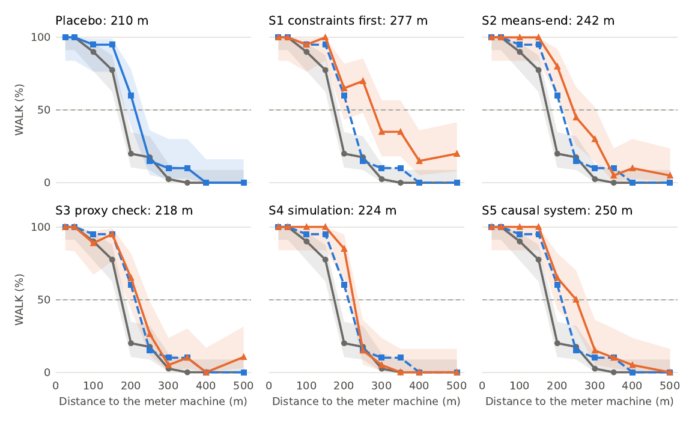

# Ask an AI to Think and It Tells You to Walk

Data and code for *Ask an AI to Think and It Tells You to Walk: Reasoning Scaffolds Shift the Walk/Drive Tipping Point on a Parking-Meter Dilemma* (Théo Nicolas Sitjar, 2026). The paper will be linked here once published.

## The question

> My parking meter expires in 3 minutes. The meter machine is **{d}** meters away. There is no parking app available. You must choose one: should I walk or drive to extend my parking time?

Driving to the machine vacates the spot the payment is for. Walking keeps the spot and risks a fine if the walk is long. At short distances WALK is plainly better; at 400 to 500 m it becomes a trade-off. We ask Claude Haiku 5.5 (low reasoning effort) this question at 10 distances from 25 to 500 m, with and without a reasoning scaffold placed before the question, and measure the distance where it stops answering WALK.



*Share of WALK answers by distance, 20 calls per point (40 for no scaffold). Grey: no scaffold. Blue dashed: placebo. Orange: scaffold. Shaded bands: 95% Wilson intervals.*

## Results

| Condition | Tipping point (50% WALK) |
|---|---|
| No scaffold (S0) | 172 m |
| Placebo (length-matched formatting instruction) | 210 m |
| S3, real question or easier one | 218 m |
| S4, simulate the actions | 224 m |
| S2, means-end analysis | 242 m |
| S5, preconditions before efficiency | 250 m |
| S1, constraints first | 277 m |

- Every scaffold moves the tipping point toward WALK. The placebo moves it too.
- S1 and S2 exceed the placebo clearly. S5 exceeds it at p = 0.044, which does not survive a Holm correction. S3 and S4 do not differ from it.
- Response length does not track the effect: S1 writes the least of the five scaffolds and shifts the curve the most.
- An exploratory blind judge (Claude Opus 5.5) finds that 92 to 98% of WALK answers under S1, S2 and S5 give the parking spot as their reason, against 72% without a scaffold and 68% with the placebo.

Scope: one question, one model, one effort level, 1,600 calls.

## Repository

| Path | Content |
|---|---|
| `runs/` | Every model call: prompt, raw response, reported model, token counts, parsed answer, timestamp |
| `judgments/` | Judge coding of the responses (Opus for all coded responses, Codex for a 20% re-coding of Studies 1 and 2) |
| `scaffolds/scaffolds.json` | Scaffold and placebo texts (S1 to S5 are verbatim from the earlier study, checked against `provenance/`) |
| `config/` | One file per study and per judge run |
| `ccb2/` | Harness: prompt building, `claude -p` and `codex exec` runners, answer parsing, judge |
| `analysis/` | Statistics and figures |
| `plans/` | Analysis plans as committed before each study, with their timing record |
| `tests/` | Offline tests |

## Reproduce the numbers

```bash
pip install -r requirements.txt
python analysis/sweep.py runs/sweep_s0s2.jsonl   # Study 1
python analysis/sweep_s4s5.py                    # all conditions, tests against S0 and placebo
python analysis/judge_sweep.py                   # judge tables
python analysis/paper_figures.py                 # paper figures (written to figures/)
pytest -q tests
```

The analysis needs no model access. Re-running the calls needs a Claude Code subscription (`claude -p`); see `ccb2/run.py`.

## Relation to the earlier study

This work revisits item T6 of the Constraint Coherence Benchmark, which reported that scaffolds hurt performance at 400 m. After correcting that study's answer scorer, its comparison is no longer significant. The present study measures the whole curve instead of one point; at 400 m nearly all conditions here answer DRIVE.

## Licence

Code: MIT (see `LICENSE`). Data and figures: CC BY 4.0.

## AI use

Claude (Anthropic), through Claude Code, wrote the harness, the analyses and a draft of the paper, and proposed parts of the design, including the placebo, the judge coding and the written analysis plans. The author chose the research question and the distance sweep, approved each run and reviewed the results.
